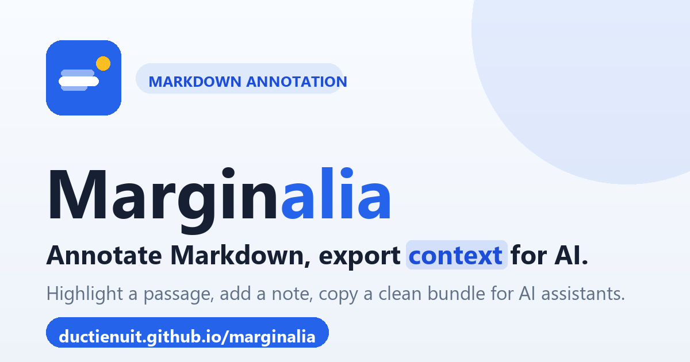

# Marginalia

**Annotate Markdown for AI review.** Marginalia is a free, single-file web app: load a
Markdown document, highlight any passage, attach a note or question, then export a clean,
structured context package to paste into ChatGPT, Claude, Gemini, or your coding assistant.

🔗 **Live app:** https://ductienuit.github.io/marginalia/

## What it does

You read a Markdown document inside Marginalia. When you select a passage, a margin note
anchors right beside it (Google-Docs style). Each note can hold a question, comment, or
edit request. When you're done, **Export for AI** copies a structured bundle that an
assistant can act on:

- the exact **quoted passage**
- its **section location** and a **line hint**
- the **surrounding context** (so duplicate wording is never confused)
- your **note / question**

## Features

- Inline, anchored annotations with a collision-free margin rail
- Highlight any passage and attach a question, comment, or edit request
- Three export modes: **full context**, **notes only**, or **raw Markdown**
- Renders GitHub-flavored Markdown and **Mermaid** diagrams
- Inline two-step delete confirm (no jarring popups)
- Keyboard accessible, responsive from mobile to desktop, `prefers-reduced-motion` aware
- Drag-and-drop a `.md` / `.markdown` / `.txt` file, or paste Markdown directly

## Privacy

Marginalia runs **entirely in your browser**. There is no server, no account, and no
tracking. Your document and notes never leave your device. Third-party libraries
(Markdown, sanitizer, diagrams) are loaded from a public CDN.

## Use it locally

It's one file — no build step. Either:

- Open `index.html` directly in a browser, **or**
- Serve the folder: `python -m http.server 8000` then visit `http://localhost:8000/`

## Tech

A single `index.html` with vanilla JavaScript and CSS. Uses
[marked](https://github.com/markedjs/marked) for Markdown,
[DOMPurify](https://github.com/cure53/DOMPurify) for sanitization, and
[Mermaid](https://github.com/mermaid-js/mermaid) for diagrams (all via CDN).
`make_og.py` regenerates the social preview image.

## License

[MIT](LICENSE) © 2026 ductienuit
